# Руководство пользователя JiraTime

## О программе {#intro}

**JiraTime** — настольное приложение для Windows и macOS, которое помогает быстро и без ошибок списывать время в Jira (worklog). Оно берёт на себя рутину: подтягивает встречи из календаря Outlook/Exchange, предлагает привычные задачи и описания, раскладывает день ровно до нормы и отправляет записи в Jira одним нажатием.

Основные возможности:

- **Собрать день** — автоматическое заполнение дня из встреч и привычных задач с редактированием на временной шкале, а также заполнение всех пропусков **одним нажатием** с возможностью отмены;
- **Мой worklog** — все ваши записи из Jira с фильтрами, правкой, копированием и экспортом в CSV;
- **Массовое логирование** — мастер для пакетного списания времени на одну задачу за период;
- **Календарь → Jira** — перенос встреч Exchange в worklog;
- **Команда** — просмотр worklog коллег и проверка корректности заполнения;
- **Дайджест** — что изменилось в проекте или у команды и где «тишина»;
- **Дашборд** — «Сегодня» с заполнением в одно нажатие, пропуски за 30 дней, итоги недели и месяца, графики и тепловая карта заполненности;
- **Битрикс24** (необязательно) — ваши задачи и задачи, за которыми вы наблюдаете: поиск, комментарии и результаты;
- **Автообновление** — новая версия ставится в одно нажатие прямо из приложения;
- **Перенос настроек** — шаблоны, правила, команды и подключения переезжают на новый компьютер одним файлом;
- **Руководство в приложении** — это руководство открывается прямо в JiraTime, с поиском и переходом к нужному экрану.

Поддерживаются Jira Cloud (atlassian.net) и Jira Server / Data Center (Basic-авторизация или Personal Access Token), Microsoft Exchange через EWS и — по желанию — Битрикс24 через входящий вебхук.

## Первый запуск {#start}

При первом запуске открывается мастер начальной настройки из четырёх шагов: *Подключение к Jira*, *Подключение к Exchange*, *Рабочий график* и *Быстрый тур*. Любой шаг можно пропустить и вернуться к нему позже в разделах «Профили» и «Настройки».

, выберите тип аутентификации (для Server/DC 8.14+ рекомендуется Bearer / PAT), введите e-mail или логин и API-токен. Ссылка «Получить токен» открывает страницу создания токена. Флажок «Не проверять TLS-сертификат» нужен только для корпоративных серверов с самоподписанным сертификатом. Кнопка «Проверить и продолжить» сразу выполняет тестовый запрос к Jira. Ссылка «Загрузить настройки из файла» — для переезда с другого компьютера (глава [«Перенос на другой компьютер»](#transfer)).")

### Порядок действий

1. **Jira.** Введите адрес и токен, нажмите «Проверить и продолжить». При ошибке приложение покажет её причину (неверный токен, недоступен сервер, проблема сертификата).
2. **Exchange.** Укажите адрес EWS (обычно `https://mail.компания.ru/EWS/Exchange.asmx`), логин и пароль. Это нужно для экранов «Календарь → Jira» и «Собрать день».
3. **Рабочий график.** Задайте норму часов в день, рабочие дни недели и часовой пояс.
4. **Быстрый тур** кратко покажет основные экраны.

> Пароли и токены хранятся в защищённом системном хранилище — в диспетчере учётных данных Windows (Credential Manager) или в связке ключей macOS (Keychain), — а не в открытом виде в файлах приложения.

**Переезд с другого компьютера.** Если JiraTime уже настроен на старом компьютере, сохраните там настройки в файл и на первом шаге нажмите «Загрузить настройки из файла»: шаблоны, правила, команды и параметры перенесутся, а форма подключения к Jira заполнится — останется ввести токен (подробнее — в главе [«Перенос на другой компьютер»](#transfer)).

## Интерфейс и навигация {#ui}

Слева расположено боковое меню со всеми разделами. Справа от названия раздела указана горячая клавиша для быстрого перехода (например, <kbd>Ctrl</kbd>+<kbd>D</kbd> — «Собрать день»; на macOS — <kbd>⌘</kbd>+<kbd>D</kbd>). Если окно узкое (меньше 1100 точек), меню само сворачивается до значков; развернуть его можно той же стрелкой. Меню можно свернуть стрелкой «‹» рядом с логотипом.

В правом верхнем углу всегда виден **индикатор синхронизации** (зелёная точка — сеть доступна, очередь пуста). Внизу слева — кнопка **ⓘ**, открывающая окно «О программе». Когда выходит новая версия, над экраном появляется плашка «Доступна новая версия» (глава [«Обновление приложения»](#updates)).

### Руководство в приложении {#guide}

Пункт **«Руководство»** в боковом меню открывает это руководство прямо в JiraTime. Оно открывается на главе того экрана, с которого вы пришли: из «Собрать день» — на главе «Собрать день», из «Настроек» — на «Настройках».

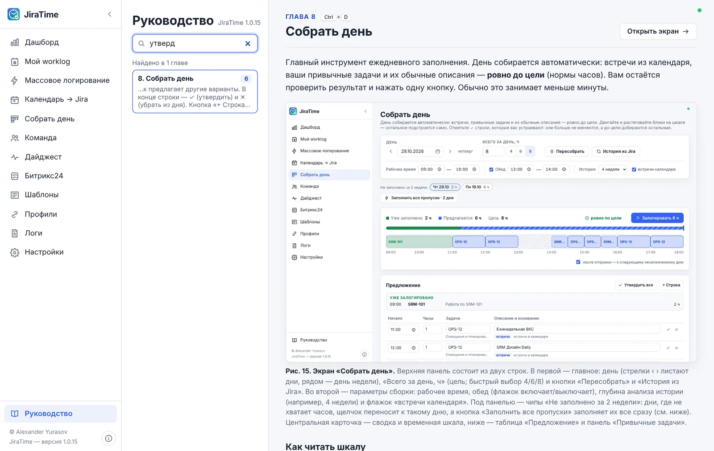

- Горячие клавиши в тексте показаны для вашей системы: на macOS — <kbd>⌘</kbd> вместо <kbd>Ctrl</kbd>.
- Руководство встроено в приложение и работает без сети; после обновления JiraTime оно обновляется вместе с ним.

## Дашборд {#dash}

Стартовый экран: что с часами сегодня, какие дни недозаполнены и как идут неделя и месяц. Главные действия — заполнить день или все пропуски — доступны прямо отсюда, одним нажатием. Данные берутся из локального кэша сразу при открытии, а свежие записи из Jira подтягиваются не чаще раза в 10 минут; кнопка «Обновить» — синхронизировать немедленно.

, «В среднем за рабочий день» и «Серия по норме» — сколько рабочих дней подряд заполнено полностью.")

, штриховка — сколько не хватает до нормы, пунктир — норма дня; при наведении — подсказка с датой, фактом и нормой. **«Разбивка часов»** — доля проектов или задач за период: быстрые периоды «Неделя / Месяц / 30 дней / 3 мес.» или свои даты; семь крупнейших показаны отдельно, остальные — строкой «Другие».")

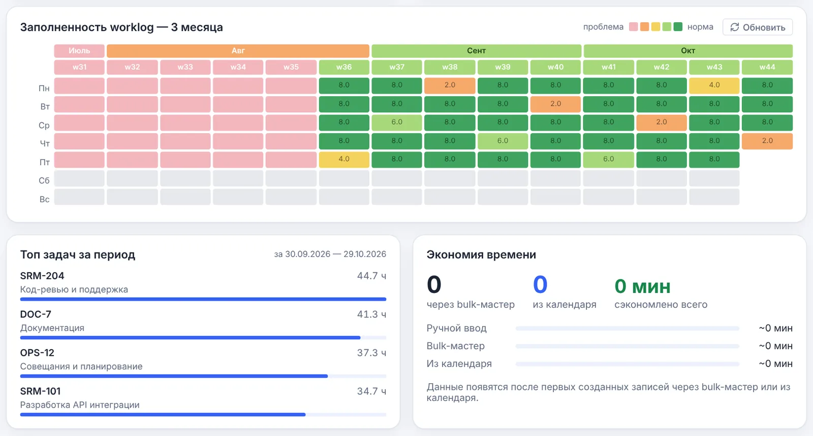

### Тепловая карта заполненности

Каждая клетка — один день, столбцы — недели, строки — дни недели. В клетке указано число списанных часов. Цвет показывает долю нормы дня: от розового («проблема», пусто) через оранжевый и жёлтый к тёмно-зелёному («норма»). Уровни считаются от вашей нормы: при норме 6 ч день с 6 ч — уже «норма». Выходные и праздничные дни без записей окрашены нейтрально-серым и не считаются проблемой; праздники с записями выделены отдельным цветом. Щелчок по клетке открывает «Мой worklog» на этой дате, щелчок по месяцу или номеру недели — на всю неделю.

## Мой worklog {#worklog}

<!-- meta: <kbd>Ctrl</kbd>+<kbd>L</kbd> -->

Таблица всех ваших записей времени, загруженных из Jira. Статус «Синхронизировано» рядом с заголовком означает, что локальные данные совпадают с Jira.

. В строке: дата, день недели, задача с названием, часы, описание, время начала и статус отправки (зелёная точка — запись в Jira). Справа — действия: изменить ✎, копировать ⧉, удалить ✕.")

Кнопки в шапке:

- **Обновить из Jira** — заново загрузить записи за выбранный период;
- **Экспорт CSV** — выгрузить текущую выборку (с учётом фильтров) в CSV для Excel;
- **Автосинхронизация** — панель периодического обновления (рисунок ниже).

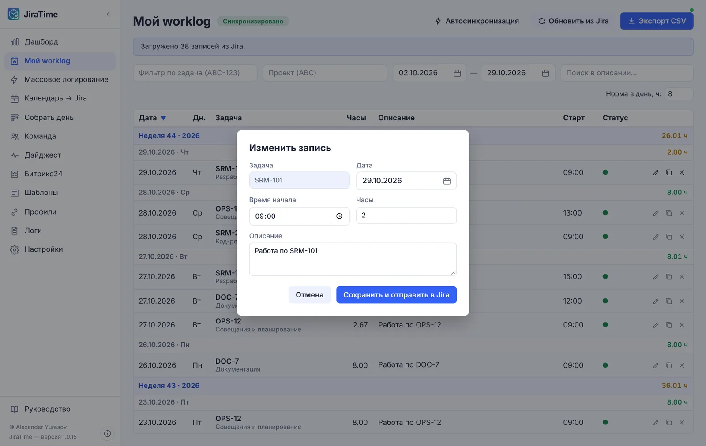

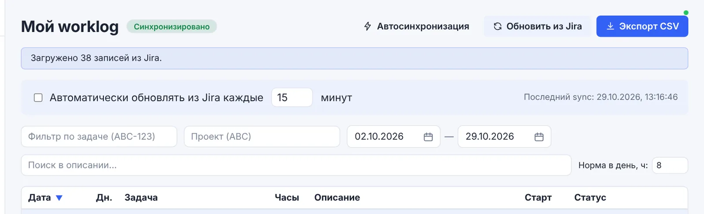

## Массовое логирование {#bulk}

<!-- meta: <kbd>Ctrl</kbd>+<kbd>N</kbd> -->

Мастер для пакетного создания записей: например, списать по 8 часов на одну задачу за всю неделю или отпуск. Состоит из четырёх шагов; прогресс показан полосой вверху. Кнопки «+ Новая сессия», «Шаблоны» и «Настройки» в шапке сбрасывают мастер, открывают сохранённые наборы параметров и общие настройки.

, вставьте ссылку на задачу или начните набирать часть названия — мастер найдёт задачу в Jira. Блок «Подсказки» предлагает недавние и избранные задачи.")

 или ручной выбор дат. Чипы «Дни недели» оставляют только нужные дни; флажок «Исключить праздники / нерабочие дни» учитывает производственный календарь.")

, текст описания с переменными `{date}`, `{week}`, `{week_number}`, `{issue}`, время начала в 24-часовом формате. Справа — сохранённые шаблоны текста: список «название — текст», щелчок по строке подставляет текст в описание. Флажок **«Не превышать норму дня»** (включён по умолчанию) учитывает уже залогированное: часы урезаются до остатка нормы, заполненные дни пропускаются, а время начала сдвигается после существующих записей, чтобы они не пересекались. Набор параметров целиком можно сохранить как шаблон мастера для повторного использования.")

. Каждую строку можно поправить или убрать («Убрать»), пропущенную — вернуть. Колонка «Статус» до отправки показывает «к отправке», предупреждение «Уже есть ваш worklog», если на эту дату по задаче уже есть ваша запись, и пояснения: «день уже заполнен», «до нормы: уже 2 ч», «начало 11:00 — после уже залогированного»; после отправки — «Отправлено» или «Ошибка». Нажмите «Подтвердить и отправить» — записи будут созданы в Jira и сразу появятся на дашборде и в «Моём worklog». Повторная отправка не создаёт дублей: уже отправленные строки пропускаются.")

## Календарь → Jira {#calendar}

<!-- meta: <kbd>Ctrl</kbd>+<kbd>K</kbd> -->

Экран «День из календаря» показывает встречи из Exchange и позволяет списать их в Jira по одной.

. Полоса недели показывает, сколько часов уже списано в каждый день. Ниже — «Залогировано за день» и строка покрытия: сколько из нормы закрыто и сколько осталось. Кнопки «Собрать день» и «Затянуть весь день →» переходят к автоматическому заполнению (глава [«Собрать день»](#compose)). Блок «Любимые задачи» — автоподбор из последних трёх месяцев: щелчок вставляет задачу в первую свободную встречу. Каждая встреча показана карточкой с временем, длительностью, предложенной задачей (метка *history* — подобрана по истории) и описанием; кнопка «▷ В worklog» отправляет её в Jira.")

> Приложение запоминает, какую задачу вы выбирали для встречи с данным названием, и в следующий раз предложит её автоматически. Звёздочка ★ рядом с задачей закрепляет её в «Любимых».

## Собрать день {#compose}

<!-- meta: <kbd>Ctrl</kbd>+<kbd>D</kbd> -->

Главный инструмент ежедневного заполнения. День собирается автоматически: встречи из календаря, ваши привычные задачи и их обычные описания — **ровно до цели** (нормы часов). Вам остаётся проверить результат и нажать одну кнопку. Обычно это занимает меньше минуты.

, «Всего за день, ч» (цель; быстрый выбор 4/6/8) и кнопки «Пересобрать» и «История из Jira». Во второй — параметры сборки: рабочее время, обед (флажок включает/выключает), глубина анализа истории (например, 4 недели) и флажок «встречи календаря». Под панелью — чипы «Не заполнено за 2 недели»: дни, где не хватает часов, щелчок переносит к такому дню, а кнопка «Заполнить все пропуски» заполняет их все сразу (см. ниже). Центральная карточка — сводка и временная шкала, ниже — таблица «Предложение» и панель «Привычные задачи».")

### Как читать шкалу

- **Сводка**: «Уже заполнено» (зелёным) + «Предлагается» (синим) = «Цель». Отметка «✓ ровно по цели» подтверждает, что сумма совпадает с нормой.
- **Зелёные блоки** — то, что уже записано в Jira; они не изменяются.
- **Синие блоки** — предлагаемые записи: встречи (сплошная рамка) и привычные задачи (пунктирная рамка).
- **Штриховка** — обед и нерабочие промежутки.

; во время перемещения на блоке виден подсказчик со временем и длительностью. После каждого изменения остальные предлагаемые блоки автоматически подстраиваются, чтобы сумма снова равнялась цели, — переработки и «лишних» часов не возникает.")

, *правка* — строка изменена вручную, *утверждено* — строка отмечена ✓. Описание подставляется из ваших прошлых записей по этой задаче; выпадающий список предлагает другие варианты. В конце строки — ✓ (утвердить) и ✕ (убрать из дня). Кнопка «+ Строка» добавляет запись вручную, «Утвердить все» отмечает все строки сразу. Ниже или справа — «Привычные задачи» за выбранный период истории: типичная длительность, обычное время начала и частота; щелчок добавляет задачу в день, галочка «в предложении» решает, подбирать ли её автоматически.")

### Утверждённые строки

Любую строку предложения можно **утвердить** кнопкой ✓ в конце строки (или все сразу — «Утвердить все»). Утверждённую строку автоматика больше не трогает: не двигает, не растягивает и не урезает. Когда вы удаляете или правите другую строку, до цели добираются **только неутверждённые** строки.

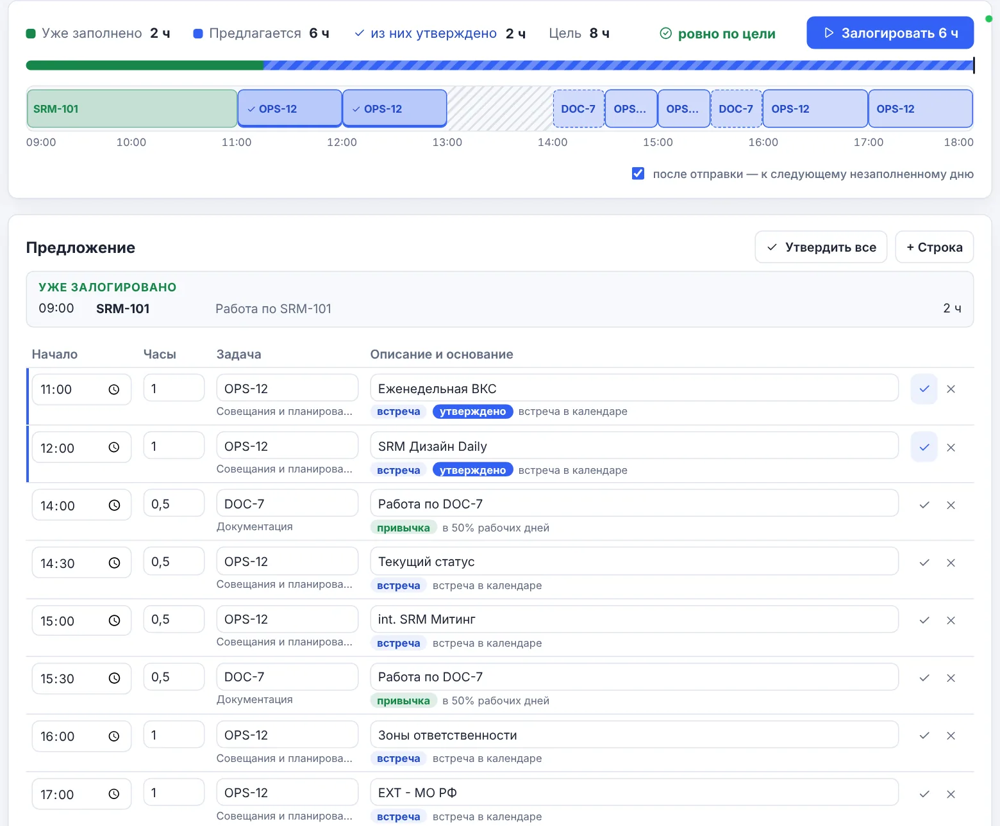

- Сама отметка ничего не пересобирает: остальные строки остаются как были.
- Удалить или поправить утверждённую строку можно как обычно — она останется утверждённой.
- «Пересобрать» забывает правки и убранные задачи, но утверждённые строки оставляет.
- Если утверждённые строки вместе больше цели, приложение их не урезает: показывает перебор и подсказку уменьшить одну из строк или снять отметку.

### Привычные задачи {#habits}

Панель «Привычные задачи» показывает задачи, которые вы регулярно списываете за выбранный период истории. **Щелчок по карточке** добавляет задачу в день: она встаёт в своё привычное время, а если оно занято — в ближайшее свободное окно рабочего дня. Мешают ей только уже залогированное, ваши правки, встречи и обед; автоматические строки перестраиваются вокруг. Если задача целиком никуда не помещается, она встаёт в самое длинное свободное окно, укороченной, и никогда не занимает больше, чем осталось до цели.

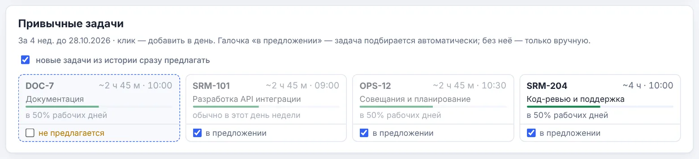

- Выбор действует и на экране, и при заполнении **«одним нажатием»**.
- Выбор запоминается и переносится на другой компьютер вместе с настройками (раздел «Параметры экранов»).
- Если выключить «новые задачи из истории сразу предлагать», задачи, которые уже есть в списке, остаются предлагаемыми; новые появятся без галочки.
- ✕ в строке предложения убирает задачу только из этого дня (до «Пересобрать»). Чтобы задача не предлагалась совсем, снимите «в предложении».

### Кнопки

| Кнопка | Действие |
|---|---|
| ▷ Залогировать N ч | Отправляет все предлагаемые строки в Jira. Если включён флажок «после отправки — к следующему незаполненному дню», экран сразу переходит к следующему дню с недобором. |
| Пересобрать | Сбрасывает ручные правки и убранные задачи и собирает день заново по текущим настройкам. Утверждённые строки остаются. |
| Утвердить все / Снять отметки | Отмечает ✓ все строки предложения или снимает отметку со всех. |
| ✓ и ✕ в строке | ✓ — утвердить строку (автоматика её больше не меняет); ✕ — убрать строку из этого дня, до цели доберут неутверждённые строки. |
| + Строка | Пустая строка в конце рабочего дня: укажите задачу, время и часы. |
| История из Jira | Обновляет историю ваших записей, на основе которой подбираются привычные задачи и описания. |

> Если в день часть времени уже списана, «Собрать день» заполняет только оставшееся время и не пересекается с существующими записями. Пересекающиеся встречи календаря объединяются, чтобы одно и то же время не было списано дважды. Если истории списаний в кэше нет (например, после установки), приложение само один раз подтягивает её из Jira.

### Одним нажатием {#oneclick}

Чтобы не открывать каждый день, пропуски можно заполнить сразу: кнопкой **«Заполнить все пропуски»** здесь, **«Заполнить все»** в карточке «Пропуски за 30 дней» на дашборде или **«Заполнить сегодня»** в карточке «Сегодня». Каждый день собирается так же, как на экране, — встречи, привычные задачи и их обычные описания ровно до нормы — и сразу отправляется в Jira.

Перед отправкой каждый день проверяется. День **пропускается** с понятной причиной, если:

- он нерабочий по графику или уже заполнен до нормы;
- собрать ровно до нормы не получается (например, нет ни привычных задач, ни встреч);
- истории списаний нет и предложена только избранная задача — такой день стоит проверить вручную;
- записи пересекаются по времени или у строки нет задачи.

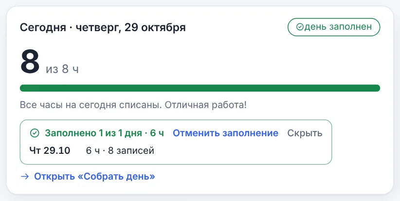

## Команда {#team}

<!-- meta: <kbd>Ctrl</kbd>+<kbd>T</kbd> -->

«Worklog коллег за период и проверка корректности заполнения». Экран для руководителей групп и всех, кому нужно видеть, кто и как заполнил время.

 и состав выбранной команды. Переключатель периода: «Эта неделя», «Прошлая неделя», «Этот месяц», «Прошлый месяц», «Период…» и стрелки. Карточки: «Списано» (с нормой на сегодня), «Заполнение» в процентах, «Ошибки» (пропуски, дубли, аномалии) и «Предупреждения» (недо- и переработки, пересечения). Сетка «Участник × день»: в клетке — часы, цвет — статус (легенда под таблицей), полоска под именем — доля заполнения нормы. Ниже — список «Проверка заполнения» с фильтрами «Все / Ошибки / Предупр. / Инфо».")

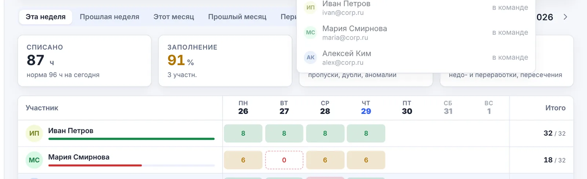

. Щелчок по клетке открывает записи участника за этот день. В списке проверок — конкретные даты, люди и причины.")

### Что проверяется

| Проверка | Уровень | Описание |
|---|---|---|
| Нет записей | ошибка | Прошедший рабочий день без единой записи. |
| Аномально много часов | ошибка | За день больше допустимого максимума — вероятная опечатка. |
| Запись на будущее | ошибка | Запись на дату позже сегодняшней. |
| Дубликат | ошибка | Две записи с одной задачей, временем начала и длительностью. |
| Меньше нормы / Переработка | предупр. | Отклонение от нормы больше допуска. |
| Пересечение по времени | предупр. | Интервалы двух записей перекрываются. |
| Работа в выходной | инфо | Записи в выходной или праздник. |
| Без описания | инфо | Записи с пустым комментарием. |

### Кнопки в шапке

- **Копировать сводку** — текстовая сводка по команде за период;
- **Копировать незаполненное** — готовое сообщение для командного чата: у кого и в какие дни не хватает часов («• Мария Смирнова: не хватает 2 ч — пн 26.10 — 6 из 8 ч»), а также список тех, у кого всё заполнено;
- **Экспорт CSV** — все записи команды за период.

## Дайджест {#digest}

<!-- meta: <kbd>Ctrl</kbd>+<kbd>J</kbd> -->

«Что изменилось в Jira за период — и где тишина: задачи без движения и люди без активности».

, «Команда» (пресет с экрана «Команда») или «Свой JQL». «Период» — за какой срок собирать изменения (сегодня … 30 дней), «Без движения дольше» — порог, после которого открытая задача считается «застывшей». «Загружать до, задач» — сколько максимум изменённых задач и задач со списаниями загружать (50–1000): меньше — быстрее. В режиме «Проекты» первой строкой идут **«Ваши проекты»** — подсказки по вашим собственным списаниям за 90 дней (часы и дата последнего списания), щелчок выбирает проект и сразу показывает дайджест. Ниже — поиск и полный список проектов Jira. Карточки-метрики: изменено задач, смен статуса, списано часов, без движения, просрочено, в работе без списаний; тревожные карточки выделены рамкой.")

> Если изменённых задач или задач со списаниями больше лимита, загружаются самые свежие, и дайджест предупреждает об этом. Списки «Без движения», «Просрочено» и «Без исполнителя» лимитом не ограничиваются: они загружаются полностью, а счётчики показывают точное число задач в Jira.

, открытые задачи без исполнителя, кто был самым активным, самая обсуждаемая задача. Метка «N новых изменений с прошлого просмотра» показывает, что появилось с вашего последнего визита. «Активность по дням» сравнивает число изменений (синие) и списанные часы (зелёные); таблица «По проектам» — задачи, изменения, часы и «тишину».")

 и автора; метка *НОВОЕ* — не просмотрено. Справа: «Активность людей», «В работе, но без списаний», «Просрочено» (с числом дней просрочки), «Без исполнителя», «Без движения». Число рядом с заголовком панели — сколько всего задач в списке.")

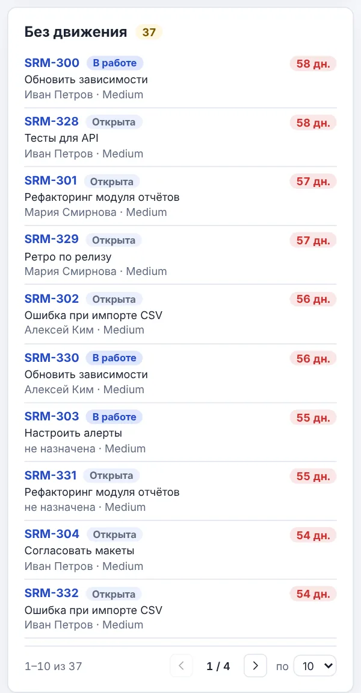

**Рис. 25. Пагинация в панелях.** Длинные списки показываются постранично. Внизу панели:

- «1–10 из 37» — какие записи на экране и сколько всего;
- стрелки ‹ › и «1 / 4» — переход между страницами;
- «по 10» — размер страницы: 5, 10, 20 или 50 строк.

Размер страницы запоминается отдельно для каждой панели: например, ленту можно смотреть по 50, а просроченные — по 5. Если всё помещается на одну страницу, переключатель не показывается.

Пагинация есть в ленте изменений, «Активности людей», «В работе, но без списаний», «Просрочено», «Без исполнителя», «Без движения», таблице «По проектам», а также в списках проектов и фильтров Jira.

### Свой JQL: сохранённые запросы и фильтры Jira

.")

. Поиск — по названию, автору и тексту JQL; «Обновить» перечитывает список из Jira. Щелчок по фильтру подставляет его JQL и показывает дайджест.")

> В Jira Cloud в списке все доступные вам фильтры. В Jira Server / Data Center — избранные и ваши собственные: чтобы командный фильтр появился в списке, добавьте его в избранное (★) в Jira.

Кнопка **«Копировать дайджест»** формирует текстовую версию для рассылки или чата.

## Битрикс24 {#bitrix}

<!-- meta: <kbd>Ctrl</kbd>+<kbd>B</kbd> · необязательно -->

Если в компании задачи ведутся ещё и в Битрикс24, их можно смотреть прямо в JiraTime: ваши задачи и задачи, за которыми вы наблюдаете, поиск, карточка с описанием, комментарии и результаты. Интеграция необязательная — пока она не подключена, раздела в меню нет.

### Подключение

1. В Битрикс24 откройте «Разработчикам» → «Другое» → **«Входящий вебхук»**.
2. Отметьте права **Задачи (task)** и **Пользователи (user)**, сохраните и скопируйте адрес вида `https://портал.bitrix24.ru/rest/1/код/`.
3. В JiraTime откройте «Настройки» → «Битрикс24», вставьте адрес и нажмите «Подключить».

, а не в файлах приложения и не попадает в файл переноса настроек. После проверки появится имя подключённого пользователя и пункт меню «Битрикс24».")

, **«Я исполнитель»**, **«Наблюдаю»**, **«Соисполнитель»**, **«Поставил я»**; статус: «Активные», «Завершённые», «Все»; поиск по названию или номеру задачи. Слева — список: название, номер, статус, крайний срок (просроченный — красным), исполнитель и проект; если задач больше 50 — «Показать ещё». Справа — карточка выбранной задачи: статус, срок, исполнитель, постановщик, проект и описание; кнопка с номером открывает задачу в браузере.")

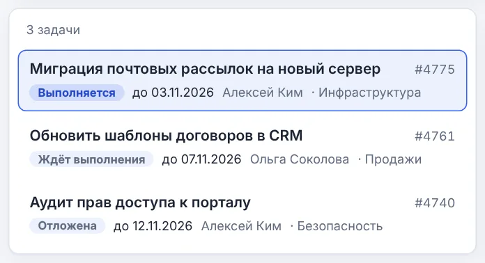

### Комментарии и результаты

. Флажок **«Отметить как результат»** делает комментарий результатом задачи — постановщик увидит его в блоке «Результат». **«Вставить списания за сегодня»** подставляет сводку ваших сегодняшних списаний из Jira: задачи, часы и описания — готовый отчёт о сделанном.")

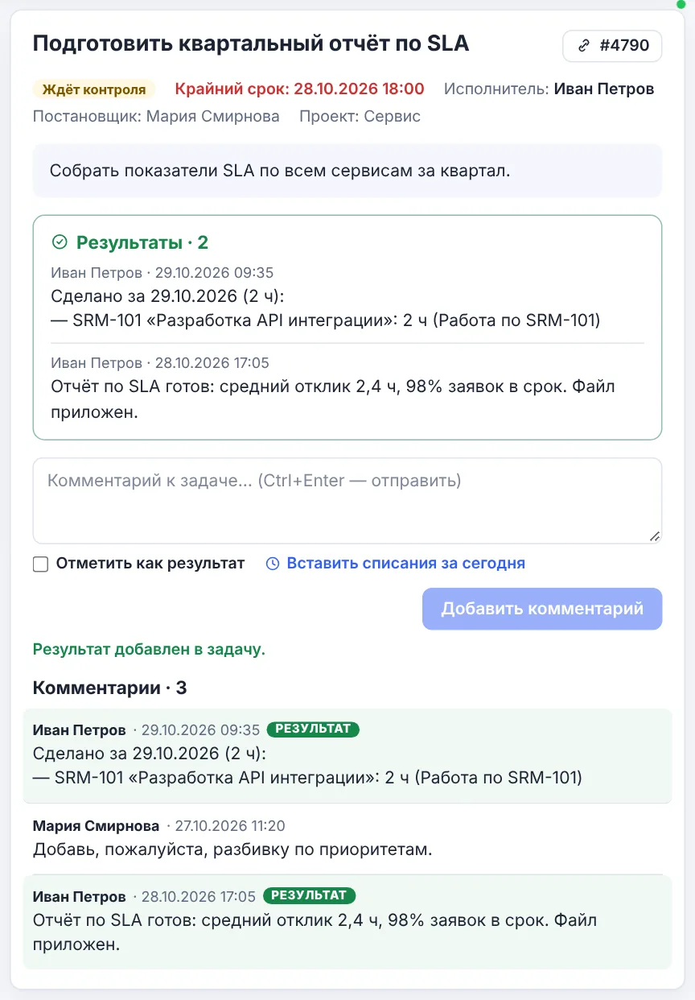

> Если при подключении или работе появляется ошибка, приложение поясняет причину: у вебхука нет прав «Задачи», вебхук удалён или недействителен, превышен лимит запросов портала. Отключить интеграцию и удалить вебхук можно в «Настройках» → «Битрикс24».

## Шаблоны описаний {#templates}

Заготовки текстов описаний worklog, которые используются в мастере массового логирования и при списании встреч.

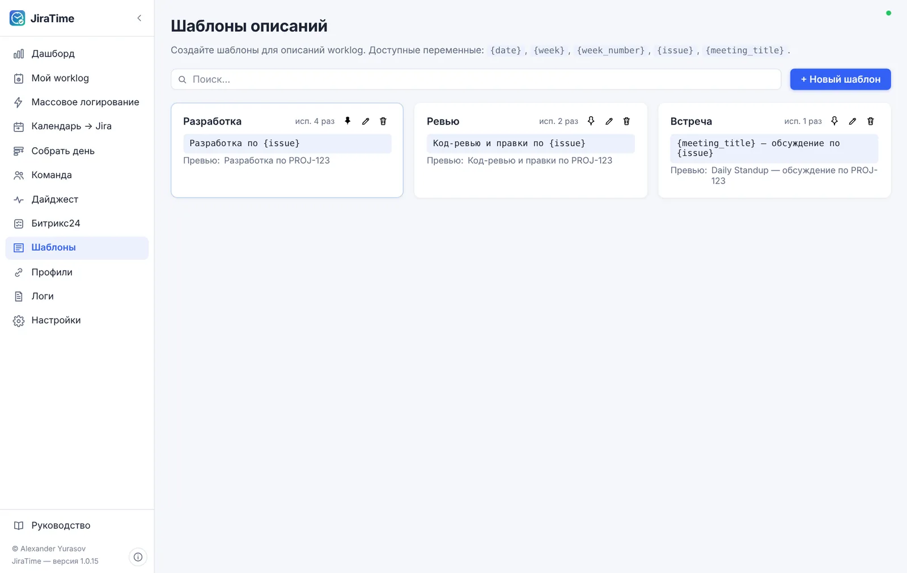

, `{week}` (неделя), `{week_number}` (номер недели), `{issue}` (ключ задачи), `{meeting_title}` (название встречи). «Закрепить» поднимает шаблон в начало списков выбора.")

## Профили подключений {#profiles}

Раздел «Подключения» хранит профили Jira и Microsoft Exchange / Outlook. Можно завести несколько профилей (например, рабочая и тестовая Jira) и переключать активный.

, пользователь, способ авторизации (Basic / PAT). Для Exchange: режим (EWS · Basic), адрес и пользователь. Зелёная точка слева — активный профиль. Действия справа: 🔗 проверить соединение, ✎ изменить, 🗑 удалить.")

; для Server / DC — адрес сервера, логин и пароль или Personal Access Token. «Сделать активным» переключает приложение на новый профиль после сохранения.")

## Настройки {#settings}

<!-- meta: <kbd>Ctrl</kbd>+<kbd>,</kbd> -->

. *Обновления*: текущая версия, проверка при запуске и «Проверить сейчас» (глава [«Обновление приложения»](#updates)). *Рабочий график*: норма часов в день, часовой пояс и рабочие дни недели — используются в «Моём worklog», на дашборде, в мастере и при проверке команды. *Напоминание о незаполненном времени*: системное уведомление, если за день списано меньше нормы; время уведомления и флажок «Только в будни». Ниже — производственный календарь, Битрикс24, *Перенос настроек* (глава [«Перенос на другой компьютер»](#transfer)) и сброс настроек.")

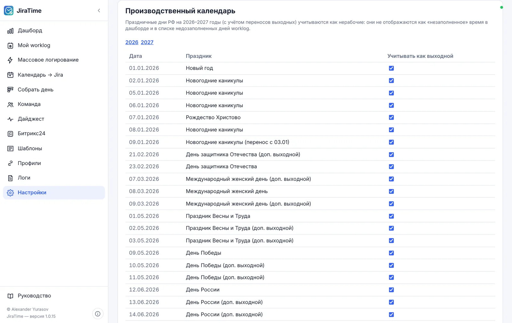

## Логи {#logs}

<!-- meta: <kbd>F1</kbd> -->

, автопрокрутка, «Обновить» и «Открыть папку». Журнал обновляется каждые 5 секунд. При обращении в поддержку приложите файл логов из этой папки.")

## О программе и лицензия {#about}

. Версия, автор — **Александр Юрасов**, контакт для связи и копирайт © 2026. Блок «Лицензия» показывает статус и срок действия; для продления введите код активации и нажмите «Активировать».")

## Синхронизация и офлайн-режим {#sync}

. Щелчок открывает панель: состояние сети и размер очереди. Если Jira недоступна (нет VPN, сбой сети), записи не теряются — они ставятся в очередь и отправляются автоматически, когда связь восстановится. «Синхронизировать сейчас» запускает отправку немедленно. Цвет значка: зелёный — Jira доступна, синий — идёт синхронизация, серый — нет сети, красный — ошибка; число рядом — количество записей в очереди.")

## Тёмная тема {#theme}

. Цвета статусов, шкалы и графиков сохраняют смысл в обеих темах.")

## Обновление приложения {#updates}

JiraTime сам проверяет, вышла ли новая версия: при запуске, не чаще раза в 6 часов. Если обновление уже найдено, но ещё не установлено, приложение напоминает о нём при каждом запуске. Проверку при запуске можно выключить в «Настройках» → «Обновления».

.")

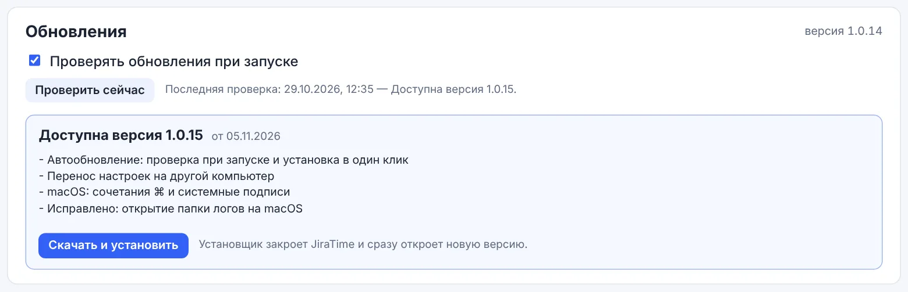

### Безопасность

Каждое обновление подписано ключом разработчика. Перед установкой JiraTime проверяет подпись и отказывается ставить файл, если он изменён или повреждён, — в плашке появится сообщение об ошибке и кнопка «Повторить». Незавершённая работа не теряется: очередь неотправленных записей хранится на диске и отправится после перезапуска.

> Если в настройках написано «В этой сборке автообновление не настроено», новые версии ставятся вручную из файла установщика. Если проверка не проходит из-за сети (например, доступ в интернет ограничен политиками компании), текст ошибки будет показан в разделе «Обновления» — установите новую версию вручную.

## Перенос на другой компьютер {#transfer}

Настройки JiraTime можно сохранить в файл и открыть на другом компьютере — например, после замены ноутбука. Переносится то, что настраивается вручную; ваши записи worklog переносить не нужно — они загружаются из Jira.

| Раздел файла | Что переносится |
|---|---|
| Рабочий график, праздники и напоминание | норма часов, рабочие дни, часовой пояс, правки производственного календаря, дополнительные выходные, напоминание и автосинхронизация |
| Шаблоны | шаблоны описаний и сохранённые шаблоны мастера массового логирования |
| Правила «встреча → задача» | какие встречи на какие задачи списывать |
| Избранные задачи | избранное в «Собрать день» и в мастере |
| Команды | состав команд и выбранный период на экране «Команда» |
| Параметры экранов | настройки «Собрать день», дайджеста и сохранённые JQL-запросы, тема, фильтры Битрикс24 |
| Подключения | адреса, логины и тип авторизации Jira и Exchange — **без паролей и токенов** |

> [!warn] Пароли, токены, вебхук Битрикс24 и лицензионные данные в файл не попадают. Но в нём есть адреса серверов и логины — храните его как рабочий документ.

### На старом компьютере

### На новом компьютере

Установите JiraTime и на первом шаге мастера нажмите «Загрузить настройки из файла» (или позже — «Настройки» → «Загрузить из файла…»).

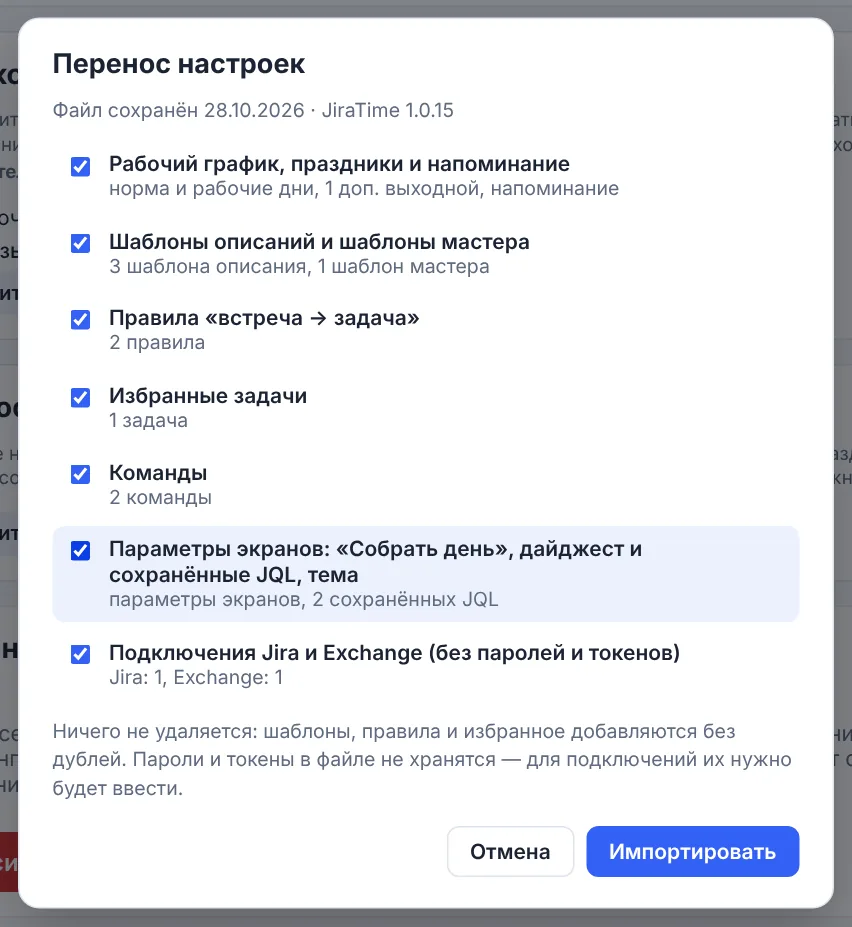

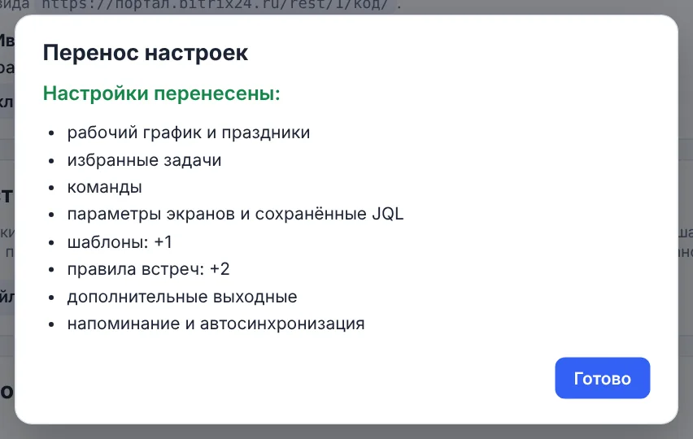

 или «Не нужно».")

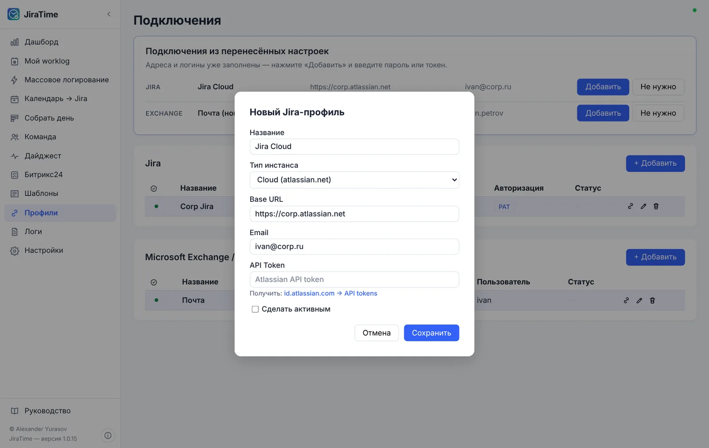

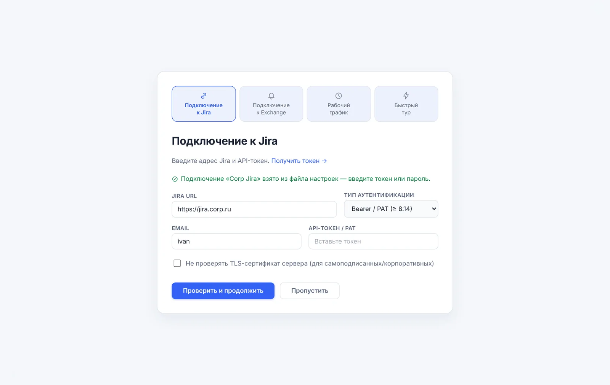

## JiraTime на macOS {#macos}

На Mac доступны все возможности приложения. Отличия — только в привычных для macOS мелочах:

- **Горячие клавиши** — с <kbd>⌘</kbd> вместо <kbd>Ctrl</kbd>: <kbd>⌘</kbd>+<kbd>L</kbd> — «Мой worklog», <kbd>⌘</kbd>+<kbd>D</kbd> — «Собрать день» и т. д. Сочетания с <kbd>Ctrl</kbd> тоже работают. Подсказки в меню показаны в виде «⌘L».
- **Автозапуск** — флажок «Запускать при входе в macOS»; JiraTime появится в «Системные настройки» → «Основные» → «Объекты входа».
- **Пароли и токены** хранятся в связке ключей macOS (Keychain).
- **Папка логов** открывается в Finder кнопкой «Открыть папку» на экране «Логи».
- **Обновления** устанавливаются так же, в одно нажатие; после установки приложение перезапускается.

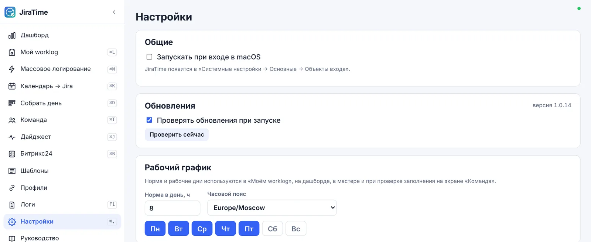

> Если при первом запуске macOS сообщает, что не может проверить разработчика, откройте «Системные настройки» → «Конфиденциальность и безопасность» и нажмите «Всё равно открыть» рядом с сообщением о JiraTime. Это нужно сделать один раз.

## Горячие клавиши {#keys}

Клавиши работают в любой раскладке (в том числе русской). На macOS вместо <kbd>Ctrl</kbd> можно нажимать <kbd>⌘</kbd>.

| Сочетание | Действие |
|---|---|
| <kbd>Ctrl</kbd>+<kbd>L</kbd> | Мой worklog |
| <kbd>Ctrl</kbd>+<kbd>N</kbd> | Массовое логирование |
| <kbd>Ctrl</kbd>+<kbd>K</kbd> | Календарь → Jira |
| <kbd>Ctrl</kbd>+<kbd>D</kbd> | Собрать день |
| <kbd>Ctrl</kbd>+<kbd>T</kbd> | Команда |
| <kbd>Ctrl</kbd>+<kbd>J</kbd> | Дайджест |
| <kbd>Ctrl</kbd>+<kbd>B</kbd> | Битрикс24 (если подключён) |
| <kbd>Ctrl</kbd>+<kbd>,</kbd> | Настройки |
| <kbd>F1</kbd> | Логи |
| <kbd>Ctrl</kbd>+<kbd>M</kbd> | Свернуть в системный трей |
| <kbd>Ctrl</kbd>+<kbd>Enter</kbd> | Показать дайджест по своему JQL; отправить комментарий в Битрикс24 |
| <kbd>Enter</kbd> / <kbd>Esc</kbd> | Сохранить / отменить редактирование, закрыть диалог |

## Частые вопросы {#faq}

### Не удаётся подключиться к Jira

Проверьте адрес (без лишнего пути после домена), тип инстанса и токен. Для Server / DC с самоподписанным сертификатом включите «Не проверять TLS-сертификат». Подробности ошибки — в разделе «Логи» (<kbd>F1</kbd>).

### Не видны встречи календаря

Убедитесь, что профиль Exchange активен и проверка соединения (🔗) проходит успешно; на экране «Собрать день» должен быть включён флажок «встречи календаря».

### Праздник отмечен как незаполненный день

Проверьте раздел «Производственный календарь» в настройках: день должен быть отмечен как выходной. Также проверьте рабочие дни недели в «Рабочем графике».

### Запись не появилась в Jira

Откройте индикатор синхронизации: если запись в очереди, нажмите «Синхронизировать сейчас». При ошибке её текст будет показан в панели и в логах.

### «Заполнить все пропуски» пропустил некоторые дни

Причина указана в итоге рядом с датой. Чаще всего день нельзя собрать ровно до нормы: нет привычных задач за выбранное окно истории и нет встреч. Откройте такой день щелчком по дате, добавьте задачи вручную и нажмите «Залогировать». Если заполнение прошло не так, как ожидалось, нажмите «Отменить заполнение» — созданные записи будут удалены.

### Битрикс24: «у вебхука нет прав «Задачи»» или «вебхук недействителен»

Откройте вебхук в Битрикс24 и проверьте права «Задачи (task)» и «Пользователи (user)». Если вебхук удалили, создайте новый и подключите его заново в «Настройках» → «Битрикс24».

### Дайджест долго загружается

Уменьшите «Загружать до, задач» (например, до 100) или сократите период. Больше всего времени уходит на историю изменений и списания по задачам — именно их ограничивает лимит. Счётчики «Без движения», «Просрочено» и «Без исполнителя» при этом остаются точными.

### Как перенести JiraTime на новый компьютер?

На старом компьютере: «Настройки» → «Перенос настроек» → «Сохранить в файл…». На новом — на первом шаге мастера «Загрузить настройки из файла» и ввести токен Jira. Подробнее — в главе [«Перенос на другой компьютер»](#transfer).

### Не удаётся проверить или установить обновление

Текст ошибки показан в плашке и в «Настройках» → «Обновления». Чаще всего это ограничения сети: проверьте подключение к интернету и VPN, затем нажмите «Проверить сейчас» или «Повторить». Если обновления в вашей сети недоступны, установите новую версию вручную из файла установщика — настройки и данные сохранятся.

### «Собрать день» предлагает не те задачи

Снимите галочку «в предложении» у ненужных задач в панели «Привычные задачи» — они перестанут подбираться автоматически (глава [«Собрать день»](#habits)). Строки, которые вас устраивают, отметьте ✓: при правках остальных они не изменятся. Если привычных задач мало, увеличьте глубину «Истории» (например, до 8 недель) и нажмите «История из Jira», затем «Пересобрать». Выбор задач для встреч приложение запоминает: после пары исправлений оно будет предлагать нужную задачу само.

> **JiraTime** · Руководство пользователя  Автор: **Александр Юрасов** · © 2026 Александр Юрасов. Все права защищены.
